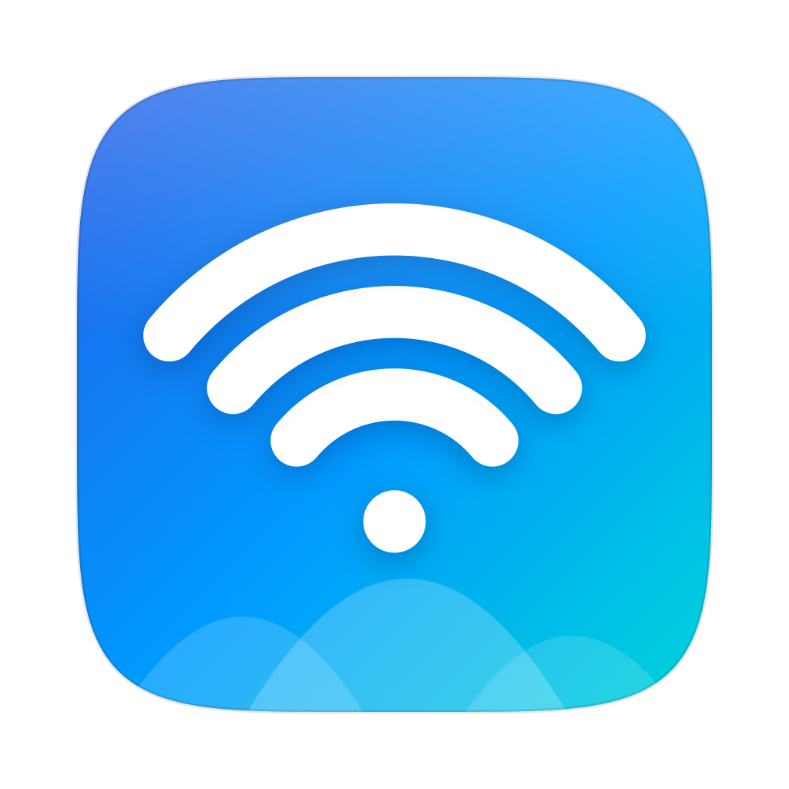
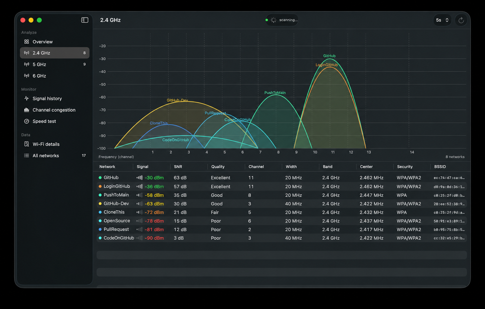

<div align="center">



# WifiShow

**Native Wi-Fi analyzer for macOS.** Monitors the 2.4 / 5 / 6 GHz bands in real time.

[](https://www.apple.com/macos/)
[](https://swift.org)
[](https://developer.apple.com/documentation/apple-silicon/building-a-universal-macos-binary)
[](LICENSE)

SwiftUI · Swift Charts · CoreWLAN · no external dependencies · 2.5 MB



<sub>2.4 GHz band — each network drawn at the frequency and width it actually occupies.<br>
Network names anonymized for the screenshot.</sub>

</div>

---

## What it is

A Wi-Fi spectrum analyzer that runs on your Mac. It shows which networks occupy
which channels, at what width and at what strength — so you can pick the right
router channel and find the best place to put it.

No subscription, no Pro tier, no telemetry, no account. **The app never touches
the network** — it only reads the local Wi-Fi radio.

## Features

| Screen | What it does |
|---|---|
| **Overview** | Connected network: RSSI, noise, SNR, channel, width, center frequency, security. Per-band counts and signal over the last 2 minutes. |
| **2.4 / 5 / 6 GHz** | Spectral analyzer for the band — every network drawn at the frequency and width it actually occupies — plus the full table. |
| **Signal history** | RSSI and SNR of the connected network, one sample per second, up to ~12 minutes. Walk around to map your coverage. |
| **Channel congestion** | How many networks sit on each channel and, on 2.4 GHz, which of channels 1 / 6 / 11 is cleanest. |
| **Speed test** | Download, upload, latency and **responsiveness (RPM)** under load, via `networkquality`. |
| **Wi-Fi details** | 22 metrics of the current connection, each with an explanation of what it means. |
| **All networks** | Single table across all bands, sortable by any column. |

Scan interval is configurable in the toolbar (3 / 5 / 10 / 30 s). `⌘R` scans immediately.

## Requirements

**To run the app:**

| | |
|---|---|
| System | macOS 14.0 (Sonoma) or later |
| Hardware | Apple Silicon or Intel — the binary is universal |
| Permission | **Location** (required, explained below) |
| Wi-Fi 6E | Optional. The 6 GHz tab only shows networks if both Mac and router support it |

**To build:**

| | |
|---|---|
| Xcode Command Line Tools | `xcode-select --install` |
| Swift | 5.9 or later (`swift --version`) |
| Full Xcode | **Not required** |
| Dependencies | None. System frameworks only |

> Tested on macOS 26.6.1 with Swift 6.2.1 and Command Line Tools 26.1.
> The declared minimum is macOS 14.0 because the app uses `@Observable` and
> `ContentUnavailableView`, both introduced in that release.

## Install

```bash
git clone https://github.com/henricop/wifishow.git
cd wifishow
./build.sh
open WifiShow.app
```

To keep it in Launchpad:

```bash
cp -R WifiShow.app /Applications/
```

### First launch

The app is **ad-hoc signed** (no paid developer certificate), so Gatekeeper
complains the first time. Since you compiled the binary yourself from this
source, it is safe to clear the quarantine flag:

```bash
xattr -dr com.apple.quarantine WifiShow.app
```

Or: right-click the app → **Open** → **Open**.

### Why it asks for Location

Since **macOS 14**, the system treats the list of nearby Wi-Fi networks as
location data — because your position can be inferred from surrounding BSSIDs.
Without the permission, CoreWLAN returns `ssid` and `bssid` as `nil`, and any
analyzer becomes an empty list.

Only the permission is used: the app does **not** read your GPS position, keeps
no location history, and has no network access at all.

## Commands

```bash
./build.sh            # builds universal (arm64 + x86_64) and signs ad-hoc
./test.sh             # suite: channel plan + networkquality parsing
./Tools/make-icon.sh  # regenerates the icon from source
```

## How it works

### Two independent loops

`Sources/Scanner.swift` runs two separate tasks, for a concrete reason:

- **Scan** (3–30 s) — `CWInterface.scanForNetworks`. It is **blocking** (2–4 s)
  and macOS throttles it. Runs in `Task.detached`, never below 3 s.
- **Telemetry** (1 s) — reads only the connected interface (`rssiValue`,
  `noiseMeasurement`). Negligible cost, and it is what gives the history
  one-second resolution without hammering the radio with scans.

### Primary channel ≠ carrier center

This is what separates a correct analyzer from an approximate one.

CoreWLAN reports the **primary channel**. A 160 MHz network is not transmitted
centered on it — it occupies a whole block, centered somewhere else:

```
Network on channel 44, 160 MHz wide

  naive   →  center 5220 MHz                    ✗  30 MHz off
  correct →  center 5250 MHz (channel 50)       ✓  occupies 5170–5330 MHz
```

How each band resolves it:

- **5 GHz** — blocks are irregular: the UNII-3 range (149–165) breaks the
  step-of-4 pattern of the channels below it. Solved with canonical
  40 / 80 / 160 MHz tables.
- **6 GHz** — regular, solved by formula: `base = span·⌊(ch−1)/span⌋ + 1`.
- **2.4 GHz** — the secondary channel direction (HT40+ or HT40−) only exists in
  the beacon's Information Element, which CoreWLAN **does not expose**. The app
  centers on the primary — a known, accepted approximation, not an oversight.

`./test.sh` validates 12 cases, including the UNII-3 and 6 GHz edges.

### Speed test without a server

`Sources/SpeedTest.swift` calls **`/usr/bin/networkquality`**, the tool built
into macOS. There is no infrastructure of our own: Apple's binary negotiates
with the nearest edge.

Beyond bandwidth it measures **responsiveness in RPM** (Roundtrips Per Minute) —
how many round trips the network sustains *while saturated*. It is the metric
that explains why a 500 Mbps connection can still stutter on a video call.
Below 200 RPM indicates bufferbloat.

Parsing is isolated in `SpeedResult.parse(_:)`, separate from process execution,
and is tested offline against real recorded output in
`Tests/fixtures-networkquality.json`.

### Details with explanations

`Sources/Details.swift` gathers what CoreWLAN exposes **only for the connected
interface** — transmit rate, power, country code, adapter MAC, PHY mode — plus
IP addresses obtained via `getifaddrs`.

Each of the 22 metrics carries a plain-language explanation in a popover. The
goal is that someone without a networking background can read the whole screen
without looking anything up elsewhere.

> Note on `transmitPower`: Apple documents the value as mW, but on modern Macs
> the reported number does not correspond to real milliwatts (the legal limit is
> around 100 mW). The app shows the raw value and says so in the explanation,
> rather than stamping it with a wrong unit.

### Noise and SNR

CoreWLAN only fills `noise` for the **connected** interface; for neighbors it
returns `0`. The app uses the locally measured noise as the floor to estimate
SNR for the others.

In other words: **the connected network's SNR is measured; the neighbors' is
estimated.** The code makes that explicit rather than faking precision it does
not have.

### Spectral curve

Each network is a parabola peaking at its RSSI, with its base spanning the
occupied width:

```
y = floor + (rssi − floor) · (1 − d²)      d = (x − center) / (width/2)
```

## Layout

```
Sources/
  Model.swift       domain: band, channel plan, network, spectral curve
  Scanner.swift     CoreWLAN + CoreLocation, the two loops
  Details.swift     connected-interface portrait + explained metrics
  SpeedTest.swift   networkquality: execution and parsing
  Views.swift       charts (Swift Charts), table, band screens
  ViewsDetail.swift speed test and details screens
  App.swift         navigation, toolbar, permission gate
Tests/
  ChannelPlanTests.swift
  SpeedTestParsing.swift
  fixtures-networkquality.json
Tools/
  MakeIcon.swift    icon generated from code (CoreGraphics), no graphics editor
Resources/
  WifiShow.icns
  screenshots/     README captures
build.sh  test.sh
```

## Portability

The app is **macOS only**, and not because of the UI:

- **CoreWLAN**, which performs the scan, exists only on macOS.
- **`/usr/bin/networkquality`** is a macOS binary.

There is no iOS version and there cannot be one: Apple deliberately blocks
Wi-Fi scanning on iOS. `NEHotspotNetwork` only reports the network you are
already joined to, and requires an entitlement Apple rarely grants.

That said, the hardest part of this project is the most portable one.
`Sources/Model.swift` — the channel plan, the primary-to-carrier-center
mapping, the UNII-3 blocks, the 6 GHz formula, the spectral curve — is pure
IEEE 802.11 and physics. Not a single line of it is Apple-specific.

A port would keep that core and replace only the acquisition layer:

| Platform | Neighbor scan | Equivalent API |
|---|---|---|
| **macOS** | ✅ | CoreWLAN *(what we use)* |
| **iOS / iPadOS** | ❌ | blocked by Apple |
| **Linux** | ✅ | `nl80211` via `libnl`, or `iw dev wlan0 scan` |
| **Windows** | ✅ | Native Wifi API (`wlanapi.dll`) |
| **Android** | ⚠️ | `WifiManager.getScanResults()` — heavily throttled since Android 9 |

## Known limitations

- **Ad-hoc signing.** Without a paid Apple Developer account there is no
  notarization. Distributing outside GitHub would require signing and notarizing.
- **No monitor mode, no packet capture.** No app outside the kernel can do that
  on modern macOS. What you can see is what CoreWLAN exposes.
- **Neighbors' PHY mode is not exposed** in scan results — only the connected
  network's (visible on the Details screen). The field exists in the neighbor
  model but stays `-`.
- **2.4 GHz at 40 MHz** is centered on the primary channel (see above).
- **Wi-Fi 7 (802.11be)** is not yet present in the current SDK's `CWPHYMode`.
- **The speed test takes ~35 s** and saturates the link on purpose: that is how
  responsiveness under load is measured.

## Contributing

Issues and PRs are welcome. Before opening a PR:

```bash
./build.sh && ./test.sh
```

Ideas already mapped out, if you want to pick one up:

- [ ] Menu bar icon with the signal always visible
- [ ] Export scans to CSV / JSON
- [ ] Local network device scanner
- [ ] Per-room coverage map built from the signal history
- [ ] Linux acquisition layer reusing `Model.swift`

## License

[MIT](LICENSE) © 2026 Henrico Piubello
